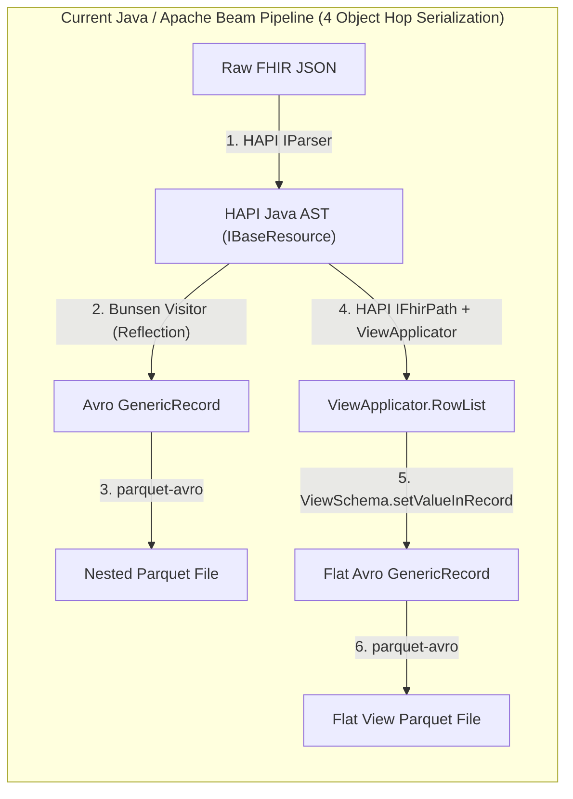
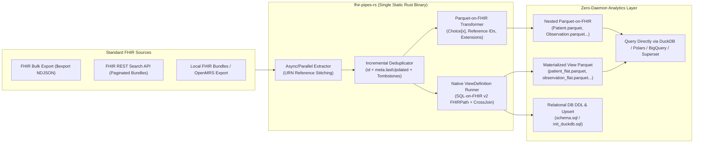

# Architectural RFC: Simplifying `fhir-data-pipes` with a Native Rust + Arrow Engine (`fhir-pipes-rs`)

## 1. Executive Summary

The Open Health Stack (OHS) `fhir-data-pipes` project solves a vital healthcare data engineering problem: **extracting deeply nested FHIR resources and transforming them into columnar Apache Parquet files ("Parquet-on-FHIR") and flat relational Materialized Views (HL7 SQL-on-FHIR v2 `ViewDefinition`)**.

However, the current architecture relies on an **Apache Beam + Apache Flink + HAPI FHIR + Forked Cerner Bunsen + Apache Avro + Apache Spark Thrift Server + Spring Boot** stack. For many healthcare deployments—from hospital edge servers and OpenMRS clinics in low-resource environments to cloud container workflows—this distributed JVM stack introduces operational complexity, high memory overhead (>5–8 GB RAM minimum), and a 4-hop in-memory serialization bottleneck.

This RFC and experimental prototype (`experimental/fhir-pipes-rs`) explore replacing that stack with a **CLI-first Rust architecture** built directly on **Apache Arrow (`arrow-rs`)** and **Apache Parquet (`parquet`)**. Eliminating the JVM, Flink cluster, Avro intermediate representation, and HAPI reflection layer reduces a multi-container 5+ GB deployment into a **single native binary** that processes **~40,000–50,000 FHIR resources per second** on a single node.

---

## 2. Where the Complexity Lives in the Current Java/Beam Architecture

### 2.1 The 4-Hop In-Memory Serialization Chain
When [`FhirEtl.java`](../../pipelines/batch/src/main/java/com/google/fhir/analytics/FhirEtl.java) ingests a FHIR JSON resource and writes it to Parquet via [`FetchSearchPageFn.java`](../../pipelines/batch/src/main/java/com/google/fhir/analytics/FetchSearchPageFn.java) and [`ParquetUtil.java`](../../pipelines/common/src/main/java/com/google/fhir/analytics/ParquetUtil.java), every single resource goes through four distinct object representations:

When regenerating Materialized Views from existing Parquet files ([`ProcessGenericRecords.java`](../../pipelines/batch/src/main/java/com/google/fhir/analytics/ProcessGenericRecords.java)), the pipeline has to **reverse** the entire chain:
1. Read Parquet into an Avro `GenericRecord` ([`FhirEtl.java`](../../pipelines/batch/src/main/java/com/google/fhir/analytics/FhirEtl.java)).
2. Convert the Avro `GenericRecord` **back into a HAPI Java `Resource` object** via [`AvroConversionUtil.convertToHapi`](../../pipelines/common/src/main/java/com/google/fhir/analytics/AvroConversionUtil.java).
3. Run HAPI's `IFhirPath` engine over the reconstructed Java object in [`ViewApplicator.java`](../../pipelines/common/src/main/java/com/google/fhir/analytics/view/ViewApplicator.java).
4. Convert the resulting `RowList` back into a new Avro `GenericRecord` in [`ViewSchema.java`](../../pipelines/common/src/main/java/com/google/fhir/analytics/view/ViewSchema.java).

### 2.2 Friction with the Apache Beam Execution Model
Instead of leveraging Beam's native `ParquetIO.sink()` during ingestion, the codebase had to work around Beam's bundle lifecycle:
- **Manual Thread-Local Parquet Writers & Timers**: [`ParquetUtil.java`](../../pipelines/common/src/main/java/com/google/fhir/analytics/ParquetUtil.java) manages a `Map<String, WriterWithCache>` synchronized across threads with a background `java.util.Timer` flushing files every $N$ seconds.
- **Runner-Specific Workarounds**: [`FetchSearchPageFn.java`](../../pipelines/batch/src/main/java/com/google/fhir/analytics/FetchSearchPageFn.java) contains special logic checking `if ("DataflowRunner".equals(...))` in `@FinishBundle` because `@Teardown` is not reliably called on Dataflow, while closing writers in `@FinishBundle` on Flink creates thousands of tiny Parquet files.
- **Flink Sharding Quirks**: In [`ParquetMerger.java`](../../pipelines/batch/src/main/java/com/google/fhir/analytics/ParquetMerger.java), explicit `.withNumShards(...)` tuning is required because `FlinkRunner` otherwise drops records when writing sharded outputs.
- **Full-Warehouse Rewrites on Incremental Sync**: Every incremental run in [`PipelineManager.java`](../../pipelines/controller/src/main/java/com/google/fhir/analytics/PipelineManager.java) writes a delta directory and then launches [`ParquetMerger.java`](../../pipelines/batch/src/main/java/com/google/fhir/analytics/ParquetMerger.java), which runs a full Flink `GroupByKey` / `CoGroupByKey` shuffle across **100% of the historical DWH and incremental files**, writes a brand-new timestamped DWH directory, and explicitly invokes `System.gc()` to avoid JVM heap exhaustion.

---

## 3. Architectural Trade-Offs: Choosing a Simpler Stack

| Dimension | Option A: Pure Rust (`arrow-rs` + `parquet` + `rayon`/`tokio`) | Option B: Rust + Embedded DuckDB | Option C: Rust + Lakehouse (`deltalake-rs` / `iceberg-rust`) |
| :--- | :--- | :--- | :--- |
| **How it works** | Streams FHIR JSON directly into Arrow columnar builders; evaluates `ViewDefinition` in native Rust; writes Parquet / SQL DDL directly. | Rust handles HTTP/FHIR extraction & `ViewDefinition` compilation into DuckDB SQL (`UNNEST`), using embedded DuckDB for Parquet & merges. | Same as Option A, but writes Parquet with a `_delta_log` or Iceberg metadata manifest for ACID upserts (`MERGE INTO`). |
| **Binary Size & Deps** | **~5–15 MB** static binary, zero C/C++ runtime deps. | **~40–60 MB** binary (links C++ `libduckdb`), longer compile time. | **~20–30 MB** binary, pure Rust (`deltalake` crate). |
| **Edge / Local Clinic Fit** | **Best**: Runs on 256 MB RAM edge VM or air-gapped server. | **Great**: Gives an instant local SQL OLAP engine in the same binary. | **Good**, though object-store transaction logs add metadata overhead if not needed. |
| **Cloud Scalability** | Scales vertically to 64+ cores via Rayon; horizontally by partitioning `$export` NDJSON files or FHIR search segments across K8s jobs. | Scales vertically on a single node (out-of-core spilling to disk). | **Best for multi-writer cloud lakes** (S3/GCS + BigQuery/Athena/Trino/Spark). |
| **Incremental Merge** | Partitioned by resource type (or patient shard) + fast Arrow/JSON key deduplication. | `INSERT OR REPLACE` / `MERGE` inside a `.duckdb` database file or Parquet export. | Native ACID `MERGE INTO` rewriting only affected Parquet files. |

### Recommended Hybrid Architecture
Build the core ETL & `ViewDefinition` engine in **Pure Rust (`Option A`)** using `serde_json`, `arrow-array`, `arrow-schema`, `parquet`, and `rayon`, while emitting an automatic **DuckDB initialization script (`init_duckdb.sql`)** and **SQL DDL (`schema.sql`)**:
- Evaluating `ViewDefinition` (`forEach`, `forEachOrNull`, `ofType`, `getReferenceKey`, cross-joins) in native Rust takes ~400 lines of code and avoids generating brittle, deeply nested SQL `LATERAL VIEW EXPLODE` queries.
- Because the output is standard **Apache Parquet**, users can immediately query both the flat views and nested Parquet-on-FHIR tables with **DuckDB**, **Polars**, **DataFusion**, **PostgreSQL**, **ClickHouse**, or **BigQuery** with **zero Spark Thrift Server or Hive Metastore required**.

