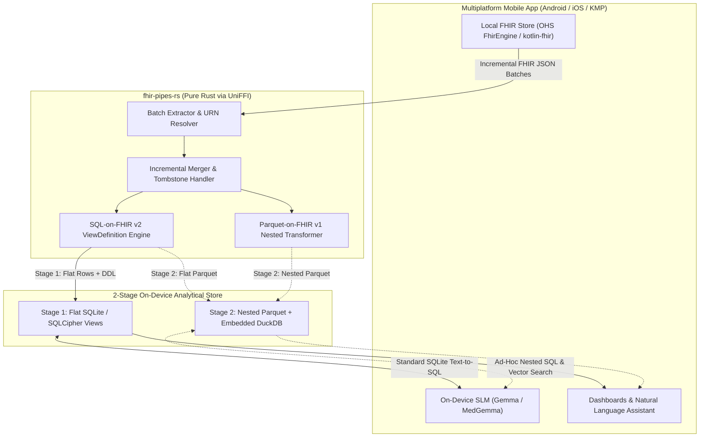
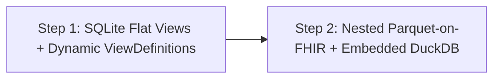

# RFC: Multiplatform On-Device SQL-on-FHIR & SLM Analytics via `fhir-pipes-rs`

| Metadata | Details |
| :--- | :--- |
| **Status** | Draft / Request for Comments |
| **Target Projects** | Open Health Stack (`fhir-data-pipes` / `fhir-pipes-rs`, `android-fhir`, `kotlin-fhir`) |
| **Target Platforms** | Android (`.aar`), iOS (`.xcframework`), Kotlin Multiplatform / Flutter (via Mozilla UniFFI) |
| **Standards** | HL7 SQL-on-FHIR v2 (`ViewDefinition`), Parquet-on-FHIR (SQL-on-FHIR v1) |
| **Estimated Effort** | Stage 1 MVP: ~2 Weeks \| Stage 2 (Parquet + DuckDB/SLM): ~2 Weeks |

---

## 1. Executive Summary

This RFC proposes packaging [`fhir-pipes-rs`](./Cargo.toml)—our lightweight, zero-JVM Rust implementation of `fhir-data-pipes` (see [`ARCHITECTURE_RFC.md`](./ARCHITECTURE_RFC.md))—as a **multiplatform native library** (`.aar` for Android, `.xcframework` for iOS, and Kotlin Multiplatform / Flutter bindings via Mozilla UniFFI) to enable **offline, on-device SQL-on-FHIR analytics and Small Language Model (SLM) data querying** inside Open Health Stack (OHS) mobile applications.

By sharing a single pure-Rust engine across server and mobile:
1. **Write Once, Run Everywhere:** Clinical indicator queries and HL7 `ViewDefinition` resources authored in the cloud execute identically offline on Android and iOS devices.
2. **SLM-Ready Local Analytics:** On-device Small Language Models (e.g., Gemma 2B/7B, MedGemma, Llama-3.2-1B/3B) can answer natural-language clinical and cohort questions offline using a staged **2-step pathway** (starting with flat SQLite views for high Text-to-SQL accuracy, and graduating to nested Parquet-on-FHIR + DuckDB for ad-hoc long-tail exploration).

> [!IMPORTANT]
> Because every dependency in [`Cargo.toml`](./Cargo.toml#L7-L17) is 100% pure Rust (`serde_json`, `arrow-*`, `parquet` with pure-Rust `snap` and `flate2`), there are **zero C/C++ or JVM runtime dependencies** blocking cross-compilation to Android (`arm64-v8a`, `armeabi-v7a`, `x86_64`) and iOS (`aarch64-apple-ios`, `aarch64-apple-ios-sim`).

---

## 2. Architecture & Multiplatform Packaging

Using **Mozilla UniFFI**, a single Rust library crate (`libfhir_pipes_rs`) generates idiomatic bindings for **Kotlin (Android / KMP)** and **Swift (iOS)** simultaneously:



---

## 3. On-Device SLMs & The 2-Step Analytics Pathway

When pairing local FHIR data with an **on-device Small Language Model (SLM)** (typically 1B–4B parameters running under tight context-window and RAM budgets), there is an important trade-off between **query accuracy** and **schema completeness** (explored in [`query/README.md`](../../query/README.md) and [`query/querygen_eval.ipynb`](../../query/querygen_eval.ipynb)):

* **Why SLMs struggle with raw Nested Parquet-on-FHIR (v1) alone:** A raw FHIR `Observation` or `Patient` table in Parquet-on-FHIR v1 has 30–50 deeply nested structs and arrays (`code.coding[].code`, `value.quantity.value`, `extension[]`). Prompting a 2B-parameter SLM with full nested schemas consumes thousands of prompt tokens and frequently produces hallucinated `UNNEST` / struct-dereference syntax.
* **Why Flat Views (v2) alone aren't enough for open-ended questions:** Pre-defined `ViewDefinition`s flatten only the columns anticipated by the developer. If a clinician asks an ad-hoc question about a FHIR field not included in any pre-built `ViewDefinition`, a static SQLite table cannot answer it.

### Recommended 2-Step Pathway for On-Device SLMs



#### Step 1: SQL-on-FHIR v2 Flat Views in SQLite + On-the-Fly View Materialization
1. **Curated Flat Views for Core Text-to-SQL (90% of queries):**
   * [`ViewDefinition::to_sql_ddl`](./src/view_definition.rs#L140-L170) generates compact, flat SQLite schemas (`patient_flat`, `vitals_flat`, `encounter_flat`) that fit in **<300 prompt tokens**.
   * Small on-device models (Gemma 2B / Llama 3B) are heavily pre-trained on standard SQLite syntax and achieve drastically higher zero-shot Text-to-SQL accuracy on flat tables than on nested structs.
2. **Dynamic On-the-Fly `ViewDefinition` Generation (Bridging the Long Tail in Step 1):**
   * Because [`ViewDefinition::apply_to_resources`](./src/view_definition.rs#L172-L175) in Rust can flatten 10,000 resources in **~20–50 ms**, the SLM can also emit a 10-line `ViewDefinition` JSON (or simple FHIRPath column list) to extract an un-modeled FHIR field on demand into a temporary SQLite table.

#### Step 2: Nested Parquet-on-FHIR (v1) + Embedded DuckDB / DataFusion
Once Step 1 is proven in production, Step 2 enables full schema-less analytical power for larger edge devices (tablets / laptops / clinic hubs):
1. **Full-Fidelity Nested Columnar Store:** [`write_nested_parquet_for_resource_type`](./src/parquet_on_fhir.rs#L222-L225) writes lossless (minus narrative text) Snappy-compressed Parquet files for every FHIR resource type on the device.
2. **Hybrid Vector + Analytical SQL via DuckDB:** Embedding DuckDB (or Apache DataFusion) allows the on-device SLM to:
   * Query **any** field across any FHIR resource without pre-defining a `ViewDefinition` (`SELECT value.quantity.value FROM Observation WHERE ...`).
   * Combine structured SQL filtering with **semantic search over clinical notes** (`DocumentReference` / `Condition.note`) using local embeddings.
   * Export ready-to-query `.parquet` bundles directly to cloud object storage or peer devices.

| Capability | Step 1: SQLite + `fhir-pipes-rs` Flat Views | Step 2: Parquet + Embedded DuckDB / DataFusion |
| :--- | :--- | :--- |
| **Binary Footprint** | **~3 MB** (uses OS-native SQLite) | **~20–30 MB** (adds embedded OLAP engine) |
| **SLM Prompt Token Cost** | **Very Low** (~200–400 tokens for flat `schema.sql`) | **High** (1,500+ tokens for nested FHIR schemas) |
| **1B–4B SLM SQL Accuracy** | **High** (standard flat SQLite `JOIN` / `GROUP BY`) | **Moderate** (requires `UNNEST` / struct path syntax) |
| **Ad-Hoc Unmodeled Fields** | Via fast on-demand `ViewDefinition` evaluation | **Native** (all FHIR fields present in Nested Parquet) |
| **Incremental Update Cost** | **$O(1)$ row upsert** in SQLite | **$O(N)$ partition rewrite / compaction** |

---

## 4. FHIR SDK Integration Boundary (`kotlin-fhir` & KMP): Pros & Cons

Because we are targeting the **new multiplatform `kotlin-fhir` libraries** (which use generated Kotlin Multiplatform data classes and `kotlinx.serialization.json` instead of legacy Java HAPI FHIR structures), the entire integration layer can live in shared KMP (`commonMain`) code across Android and iOS.

For the **FHIR SDK team**, there are four architectural options to consider for how `fhir-pipes-rs` ingests FHIR resources from the local SDK store:

### Option 1: Public `FhirEngine` APIs via `kotlin-fhir` Models (`kotlinx.serialization`)
The app queries `com.google.fhir.model.r4.Resource` instances through `FhirEngine` in `commonMain`, re-encodes them to JSON strings via `kotlin-fhir`'s `FhirR4Json` (`kotlinx.serialization`), and passes the JSON batch over UniFFI to Rust.

* **Pros:**
  * **Zero changes required in the FHIR SDK:** Works out of the box against public SDK interfaces in `commonMain`.
  * **Significantly lighter than legacy HAPI:** `kotlin-fhir` uses compile-time generated `kotlinx.serialization` serializers rather than JVM reflection, making it KMP-native (Android & iOS) and much faster than HAPI.
  * **Strict encapsulation:** Respects all SDK database migrations, encryption keys, and access controls.
* **Cons:**
  * **Avoidable `JSON -> Kotlin Data Class -> JSON` Round-Trip:** The local database (`ResourceEntity`) already stores serialized FHIR JSON strings on disk. Loading 10,000 resources via `FhirEngine.search()` instantiates 10,000 deeply nested `kotlin-fhir` object trees in Kotlin/Native or ART memory only to immediately serialize them back into UTF-8 JSON strings for Rust.
  * **Change Tracking Overhead:** Requires polling or querying `LocalChange` tables to know which resources were updated or deleted since the last analytics materialization.

### Option 2: Direct Read-Only SQLite / SQLCipher Access to `ResourceEntity`
`fhir-pipes-rs` opens a read-only connection to the SDK's underlying SQLite/SQLCipher file and `SELECT`s `(resourceType, resourceUuid, serializedResource)` directly from `ResourceEntity` / `LocalChangeEntity`.

* **Pros:**
  * **Zero `kotlin-fhir` Deserialization Overhead:** Raw UTF-8 JSON bytes flow directly from SQLite C cursors into Rust's `serde_json` at >50,000 resources/sec with zero Kotlin heap allocations.
  * **Direct CDC Inspection:** Can read `LocalChangeEntity` and `ResourceEntity.lastUpdated` directly in SQL.
* **Cons:**
  * **Tight Coupling to Private SDK Storage Internals:** Any Room KMP / SQLDelight schema change in `ResourceDatabase` breaks the analytics reader.
  * **Platform-Specific Encryption Plumbing:** Requires sharing SQLCipher keys/handles across the Kotlin/Rust boundary on both Android and iOS.

### Option 3: First-Class Raw-JSON CDC / Batch Hook in KMP `FhirEngine` *(Recommended for SDK Team)*
The FHIR SDK exposes a lightweight, KMP-native API in `commonMain` (e.g., `getRawJsonChanges()` or `Flow<RawResourceChangeBatch>`) that streams `ResourceEntity.serializedResource` UTF-8 strings/bytes directly from the DAO **without** deserializing them into `kotlin-fhir` `Resource` instances first.

```kotlin
// Proposed KMP commonMain addition to FhirEngine:
interface FhirEngine {
    suspend fun getRawJsonChanges(
        sinceToken: ChangeToken?,
        batchSize: Int = 500
    ): RawJsonChangeBatch // List<RawResourceRecord(type, id, utf8JsonBytes, isDeleted)> + nextToken
}
```

* **Pros:**
  * **Best of Both Worlds:** Eliminates the `JSON -> kotlin-fhir -> JSON` round-trip while keeping database schemas and SQLCipher encryption 100% encapsulated inside the FHIR SDK.
  * **High Value for Other KMP Features:** A raw JSON stream in `commonMain` also accelerates bulk FHIR `$export`, cloud sync uploads, and on-device SLM RAG pipelines that don't need typed Kotlin ASTs.
* **Cons:**
  * Requires a small upstream addition (~100 lines of DAO + `commonMain` interface code) in the FHIR SDK.

### Option 4: Direct FFI Struct Mapping (`kotlin-fhir` Models $\leftrightarrow$ Rust Structs)
Instead of passing JSON strings across FFI, pass typed `kotlin-fhir` data classes directly into Rust via UniFFI / C-ABI structs.

* **Pros:**
  * Avoids `serde_json` parsing on the Rust side if the host app already holds an in-memory `kotlin-fhir` `Resource` instance.
* **Cons:**
  * **FFI Marshaling Bottleneck & Code Bloat:** UniFFI/C-ABI must allocate and copy every nested struct, `List`, and `Option` field-by-field across the FFI boundary, and requires generating C-ABI glue for 140+ FHIR R4 resource types (~10+ MB binary bloat).
  * **Slower than Contiguous UTF-8 Buffers:** Passing a contiguous `ByteArray` of UTF-8 JSON (Option 3) is a single pointer+length transfer across FFI, which Rust's `serde_json` parses in microseconds.

| Integration Option | `kotlin-fhir` Round-Trip? | SDK Changes Needed | FFI / Memory Efficiency | SDK Encapsulation |
| :--- | :--- | :--- | :--- | :--- |
| **Option 1: Public `FhirEngine` (`kotlin-fhir`)** | Yes (`DB -> Kotlin -> JSON`) | **None** | Moderate | **Full** |
| **Option 2: Direct SQLite Table Read** | **No** (`DB -> Rust`) | **None** | **Highest** | Low (couples to DB schema) |
| **Option 3: SDK Raw-JSON CDC Hook *(Rec.)*** | **No** (`DB -> ByteArray -> Rust`) | **Small DAO API** | **Highest** | **Full** |
| **Option 4: Typed FFI Struct Marshaling** | Yes (`DB -> Kotlin -> C-ABI`) | None (huge FFI glue) | Low (per-field FFI copy) | Full |

> [!TIP]
> **Recommendation for the FHIR SDK Team:** Use **Option 1 (`kotlin-fhir` + `FhirR4Json`)** for single-resource real-time mutations where the app already has the `kotlin-fhir` object in memory, and add **Option 3 (`getRawJsonChanges`)** in the SDK for bulk initial loads and post-sync incremental batches so large syncs bypass `kotlin-fhir` object instantiation entirely.

---

## 5. Implementation Roadmap

### Stage 1: Multiplatform Core & SQLite Flat Views (Weeks 1–2)
1. **Crate Refactor & UniFFI (`2–3 days`):**
   * Extract `src/lib.rs` from [`src/main.rs`](./src/main.rs).
   * Add UniFFI interface definitions generating Kotlin Multiplatform (Android/iOS) and Swift bindings.
2. **Incremental SQLite Sink & CDC (`2–3 days`):**
   * Attach source `_resource_id` metadata to [`FlattenedTable`](./src/view_definition.rs#L118-L122) rows.
   * Implement transactional batch `DELETE` + `INSERT` into SQLite using [`ViewDefinition::to_sql_ddl`](./src/view_definition.rs#L140-L170).
3. **Mobile Memory & Thread-Pool Guardrails (`2 days`):**
   * Replace full-dataset `Vec<Value>` materialization with chunked batch iterators and cap `rayon` threads.
4. **Multiplatform CI Packaging (`2 days`):**
   * Build Android `.aar` (`cargo-ndk`), iOS `.xcframework`, and KMP wrapper module compatible with `kotlin-fhir`.

### Stage 2: Nested Parquet + Embedded DuckDB & SLM Agent Integration (Weeks 3–4)
1. **Incremental Parquet Partitioning (`3 days`):**
   * Enable partitioned Parquet output by resource type and sync batch so [`write_nested_parquet_for_resource_type`](./src/parquet_on_fhir.rs#L222-L225) can update on-device Parquet datasets without rewriting the entire history on every sync.
2. **On-Device SLM Tool-Use Harness (`3–4 days`):**
   * Connect MediaPipe LLM Inference API (Gemma) / `llama.cpp` to two local tools:
     * `query_flat_views(sql)` (Step 1 fast path over SQLite)
     * `define_temp_view(view_definition_json)` or `query_nested_parquet(duckdb_sql)` (Step 2 deep inspection path).

---

## 6. Summary of Decisions for Community Review

1. **Adopt the 2-Step SLM & Analytics Pathway:** Ship **Stage 1 (SQL-on-FHIR v2 Flat Views in SQLite)** as the lightweight default for all mobile apps and SLM Text-to-SQL, with **Stage 2 (Nested Parquet + DuckDB)** as an opt-in module for advanced ad-hoc SLM exploration.
2. **Target Kotlin Multiplatform (KMP) + `kotlin-fhir` via UniFFI:** Generate both **Android (`.aar`)** and **iOS (`.xcframework`)** artifacts so the analytics engine pairs natively with `kotlin-fhir` in `commonMain`.
3. **Align with the FHIR SDK Team on Hybrid Option 1 + Option 3:** Use `kotlin-fhir`'s `kotlinx.serialization` (`Option 1`) when a mutated `Resource` is already in memory, and propose the `getRawJsonChanges()` DAO hook (`Option 3`) to avoid deserializing stored JSON into `kotlin-fhir` objects during bulk/post-sync analytics updates.
